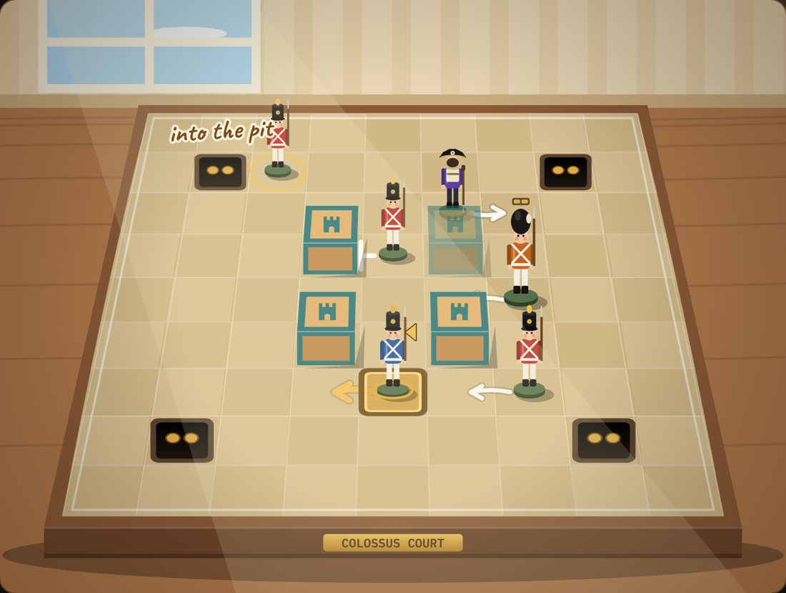

# Lockstep

A turn-based tactical roguelite where **the room copies your every move**.



**Play it:** https://heidenreich.github.io/lockstep/ (your runs are saved in your browser)

## How it plays

You're a blue tin cadet on a toy parade ground. When you step, the enemy line steps the same way, so you win by steering it rather than fighting it:

- **Into pits.** An enemy that steps into a pit is gone; you stop at the edge. Each pit takes a couple, then fills.
- **Against walls.** Pin an enemy against a tower block, the edge or another soldier. Blocked three turns running, it breaks free and chases you.
- **Into trouble.** A powder keg that gets bumped blasts everything beside it; spikes hurt, ice slides, belts carry.
- **Contrarians** step the opposite way, **heavies** hit harder and move every other turn, **riflemen** hold still and fire along their row or column once loaded.
- **Move cards** break the rule for one turn: move without the room, move the room without you, lunge, shove, open a trapdoor. Each goes on cooldown; Step is always free.

Finish a room fast: at turn 30 a frenzy frees every enemy.

## A run

Three acts (the parade ground, the barracks, the citadel), each a branching map of fights, elite fights, rests, shops and events, ending in a boss: the **Colossus**, the **Mirror** and the **Warden**. After a fight you draft a card or take gold; bosses offer perks. A run takes about 25 minutes.

Progress is **unlocks only**, never permanent power: two more cadets (the Drummer and the Sapper), more cards, and five Cadence levels of extra difficulty, each unlocked by winning at the one before. A short training drill teaches the rules on your first run.

## Run it locally

Open `index.html` through any local web server (it loads `rules.js`, `styles.css` and `js/` next to it):

```bash
python3 -m http.server 8000
```

## Docs

- [docs/development.md](docs/development.md): working on the code (commands, file layout, saves, adding cards, enemies, rooms and more).
- [docs/design.md](docs/design.md): how the game works today, in full (rules, cards, enemies, run, meta, presentation).
- [docs/history.md](docs/history.md): the dated design and balance passes, with bot numbers and why things changed.
